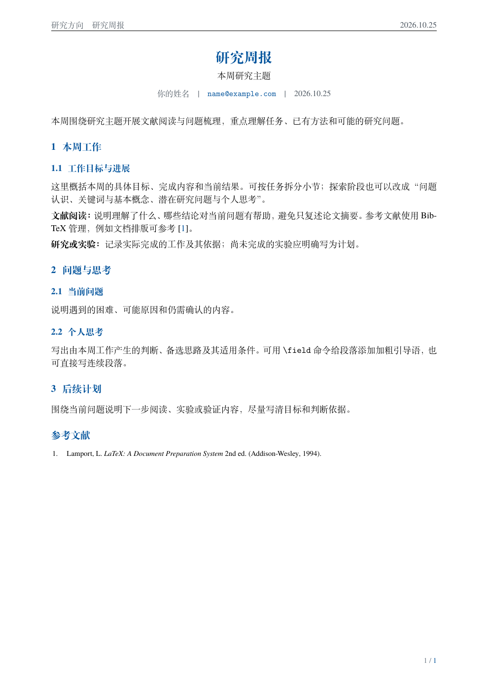

# LaTeX Templates

个人常用 LaTeX 模板合集。模板与实际文档分开维护，方便复用和逐步完善。

| 分类 | 状态 | 说明 |
| --- | --- | --- |
| [研究周报](weekly-report/) | 可用 | 中文 A4、蓝色标题、单日日期、姓名与邮箱、连续排版、参考文献 |
| [简历](resume/) | 待添加 | 预留分类，尚无简历模板 |

## 周报预览



[查看完整示例 PDF](assets/weekly-report.pdf)

## 快速使用

复制 `weekly-report` 目录到自己的文档目录，修改 `week.tex` 中的姓名、邮箱、日期与主题，再修改 `content.tex` 正文和 `references.bib` 参考文献。

安装 TeX Live（XeLaTeX、latexmk、Biber）。在模板目录中运行：

```powershell
./build.ps1
```

macOS / Linux 或直接命令：

```sh
latexmk -norc -xelatex -interaction=nonstopmode -halt-on-error main.tex
```

也可把模板目录中的 `.tex`、`.bib` 文件上传 Overleaf，编译器选 XeLaTeX。产物为 `main.pdf`。标题和段落自然分页，无需手动插入换页命令。

## 添加更多模板

按用途新建独立目录，包含完整源码、使用说明和匿名示例；如改编自其他项目，保留来源与许可证。不要将真实简历、个人周报、私人附件或编辑器配置放进公开仓库。

## 许可

当前周报模板改编自 GPL-3.0 项目，见 [NOTICE.md](NOTICE.md) 与 [LICENSE](LICENSE)。